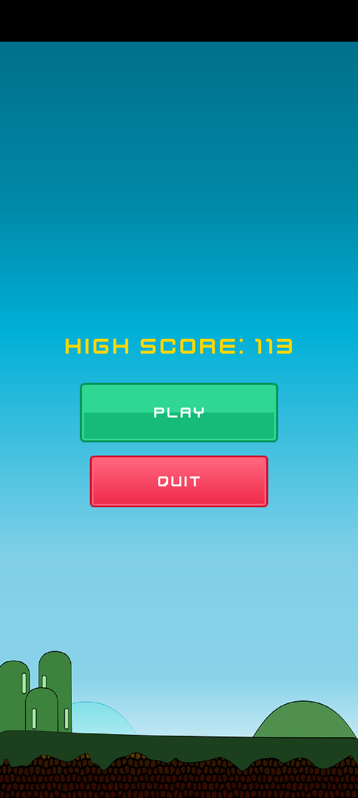
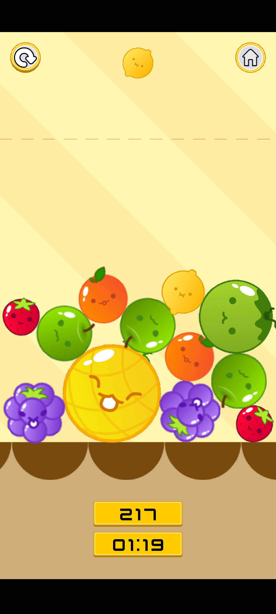
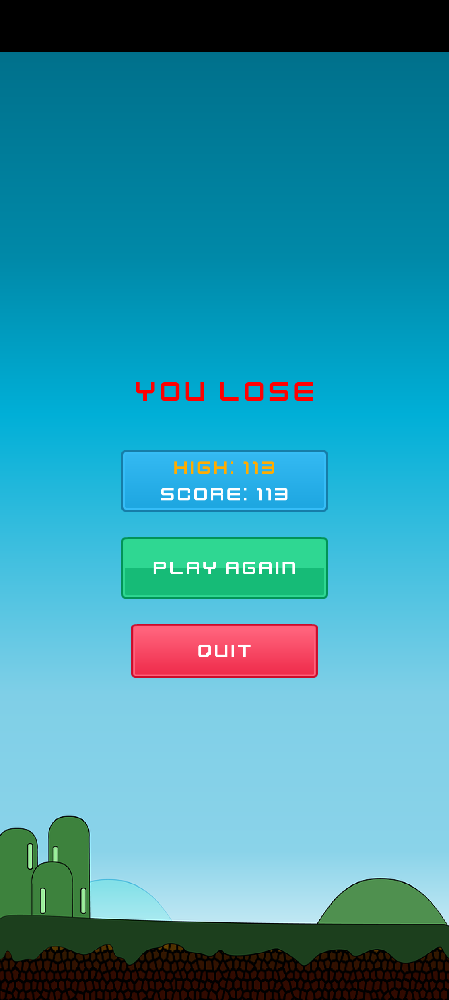

# Fruit Merge

A physics-based fruit merging puzzle game for desktop and Android: drop fruits, match pairs, and score as high as you can before the clock runs out.

The game was presented at the National University tech fiesta.

## Screenshots

| Main menu | Gameplay | Game over |
| --- | --- | --- |
|  |  |  |

## How to play

- Press **Play** on the main menu. The menu shows your current high score.
- Press (or touch) the play area to pick up the next fruit, drag left or right to position it near the top, and release to drop it. The fruit that comes next is shown as a preview at the top of the screen.
- When two fruits of the **same type** touch, they merge: one becomes the next fruit in the chain and the other disappears.
- The merge chain has nine fruits, from smallest to largest: strawberry, lemon, orange, apple, grapes, melon, coconut, pineapple, watermelon. Only the first five can be dropped; the larger ones come from merging.
- Two watermelons that touch simply vanish, with no extra points.
- The **score** goes up on every merge by the points of the fruit that was merged:

  | Fruit | Strawberry | Lemon | Orange | Apple | Grapes | Melon | Coconut | Pineapple |
  | --- | --- | --- | --- | --- | --- | --- | --- | --- |
  | Points | 1 | 3 | 6 | 10 | 15 | 20 | 25 | 30 |

  Merging two pineapples into a watermelon is the biggest merge, worth 30 points.
- You have **2 minutes** (02:00). The timer starts when you release your first fruit, and the remaining time is shown under the score.
- **Game over** happens when the timer reaches zero, or when a fruit rises above the dashed red line near the top of the play area.
- On game over your score is compared with the saved high score, and the new best is stored on the device. The game over screen shows both numbers and lets you play again or quit.
- The buttons at the top of the play area restart the round (top left) or return to the main menu (top right).

## Features

- Box2D physics: gravity, bouncing, friction, and stacking fruits in a container
- Nine-stage fruit merge chain with a growing hit-box for each stage
- Score display and a 2-minute countdown timer
- Next-fruit preview
- Danger line that ends the game when the pile gets too high
- Persistent high score, shown on the main menu and game over screen
- Main menu, game screen, and game over screen with restart and home buttons
- Background music
- Runs on desktop (LWJGL3) and Android from a single shared codebase

## Tech stack

- Java
- [libGDX](https://libgdx.com/) 1.13.1
- Box2D (physics, via `gdx-box2d`)
- FreeType (font rendering, via `gdx-freetype`)
- Gradle
- Android and desktop (LWJGL3) backends

## Project structure

| Folder | Contents |
| --- | --- |
| `core/` | Shared game code: screens (main menu, game, game over), `Fruit`, `HighScoreManager`, and the `FruitMergeGame` entry point |
| `android/` | Android launcher, manifest, and app resources |
| `lwjgl3/` | Desktop launcher and packaging configuration |
| `assets/` | Sprites, font, background images, and audio shared by both platforms |

## Running the game

### Requirements

- JDK 17 or newer. The code targets Java 8 bytecode, but the Android Gradle Plugin used by the build (8.5.2) needs JDK 17 to run Gradle. The project ships with the Gradle wrapper (Gradle 8.12), so no separate Gradle install is needed.
- For Android: Android Studio (or the Android SDK with platform 34) and a device or emulator running Android 4.4 (API 19) or later.

### Desktop

```bash
./gradlew lwjgl3:run
```

On Windows you can use `gradlew.bat lwjgl3:run`.

To build a runnable jar (`lwjgl3/build/libs/FruitMerge-1.0.0.jar`):

```bash
./gradlew lwjgl3:dist
java -jar lwjgl3/build/libs/FruitMerge-1.0.0.jar
```

### Android

Open the project in Android Studio and run the `android` configuration, or with a device or emulator connected:

```bash
./gradlew android:installDebug
```

## Credits

- The font "Kenney Future" and the button and UI icon sprites are by [Kenney](https://kenney.nl) and released under CC0.

## License

The source code is released under the [MIT License](LICENSE). Third-party assets keep their own licenses.
